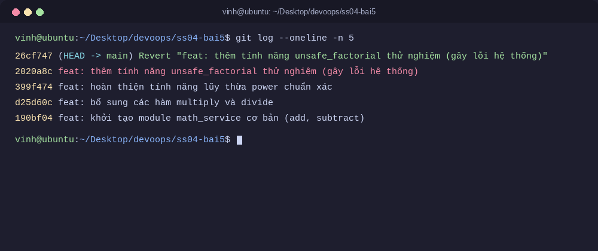

# Bài 5: Khôi phục trạng thái và Đảo ngược commit (Reset vs Revert)

## Thông tin bài tập
- **Học viên:** Vinh Nguyen
- **Môn học:** DevOps (IT209) - Session 04
- **Đường dẫn nộp bài trên GitHub:** `homework/session_04/ex5/`

---

## 1. Mục tiêu bài thực hành
1. Ứng dụng thành thạo hai cơ chế `git reset` và `git revert` để xử lý và sửa chữa sai sót trong lịch sử dự án Git.
2. Phân biệt rõ sự khác nhau giữa **khôi phục/viết lại lịch sử cục bộ** và **đảo ngược lịch sử an toàn** khi làm việc nhóm trên nhánh chung.
3. Nắm vững nguyên tắc bảo toàn mã nguồn khi thao tác lùi commit trên máy local.

---

## 2. Trường hợp 1: Sửa đổi cục bộ (Local Reset)

### 2.1. Bối cảnh & Tình huống
Trong quá trình phát triển module tính toán `math_service.py`, học viên tạo ra commit cục bộ chứa mã nguồn bị lỗi logic:
```text
commit 47a6336: "feat: thêm tính năng lũy thừa power (lỗi logic)"
```
Commit này chỉ mới tồn tại ở máy cá nhân (Local Repository), chưa từng được đẩy lên máy chủ từ xa (Remote Repository).

### 2.2. Yêu cầu & Ràng buộc
- Di chuyển con trỏ `HEAD` lùi lại 1 commit.
- Giữ lại các tệp tin thay đổi ở dạng chưa chuẩn bị (`unstaged` / `modified`) trong thư mục làm việc để viết lại code.
- **Ràng buộc:** Tuyệt đối không làm mất mã nguồn hiện hành (không dùng `git reset --hard`).

### 2.3. Lệnh thực hiện
Sử dụng chế độ Mixed Reset (mặc định của Git):
```bash
git reset HEAD~1
# hoặc tương đương: git reset --mixed HEAD~1
```

### 2.4. Phân tích cơ chế 3 cấp độ của `git reset`
- `git reset --soft HEAD~1`: Chỉ di chuyển con trỏ `HEAD` lùi lại 1 commit. Các thay đổi được giữ nguyên tại **Staging Area** (vùng chuẩn bị commit).
- `git reset --mixed HEAD~1` (Mặc định): Di chuyển con trỏ `HEAD` lùi lại 1 commit đồng thời xóa bỏ các tệp khỏi Staging Area, nhưng **giữ nguyên toàn bộ nội dung sửa đổi trong Working Directory** dưới dạng chưa chuẩn bị (`modified/unstaged`). Đây chính là tùy chọn đáp ứng chính xác yêu cầu đề bài.
- `git reset --hard HEAD~1`: Di chuyển `HEAD`, reset Staging Area và **xóa sạch toàn bộ thay đổi trong Working Directory** về trạng thái của commit cũ. Tùy chọn này gây mất code và vi phạm ràng buộc bài tập.

### 2.5. Kết quả kiểm tra Trường hợp 1
Kiểm tra trạng thái sau khi reset:
```bash
git status
```
**Kết quả hiển thị:**
```text
On branch main
Changes not staged for commit:
  (use "git add <file>..." to update what will be committed)
  (use "git restore <file>..." to discard changes in working directory)
	modified:   homework/session_04/ex5/math_service.py

no changes added to commit (use "git add" and/or "git commit -a")
```
$\rightarrow$ Con trỏ `HEAD` đã lùi lại 1 commit, toàn bộ mã nguồn vẫn còn nguyên trong Working Directory ở trạng thái `modified` để học viên tiếp tục chỉnh sửa.

Sau khi sửa lại hàm `power` chuẩn xác bằng toán tử `**`, học viên tiến hành commit phiên bản hoàn chỉnh:
```bash
git add homework/session_04/ex5/math_service.py
git commit -m "feat: hoàn thiện tính năng lũy thừa power chuẩn xác"
```

---

## 3. Trường hợp 2: Sửa đổi công cộng (Public Revert)

### 3.1. Bối cảnh & Tình huống
Học viên tiếp tục phát triển tính năng và tạo commit:
```text
commit 2020a8c: "feat: thêm tính năng unsafe_factorial thử nghiệm (gây lỗi hệ thống)"
```
Giả định đây là commit đã được đẩy lên Remote Repository hoặc nằm trên nhánh phát triển chung (`main` / `develop`) mà nhiều thành viên trong nhóm đã kéo về (`pull`). Tính năng này phát sinh lỗi nghiêm trọng và cần phải thu hồi ngay lập tức.

### 3.2. Yêu cầu & Ràng buộc
- Đảo ngược thay đổi của commit lỗi mà **không được viết lại lịch sử**.
- **Ràng buộc:** Bắt buộc tạo ra một commit mới đối lập để ghi lại lịch sử đảo ngược rõ ràng, bảo đảm an toàn khi đẩy lên remote.

### 3.3. Lệnh thực hiện
```bash
git revert HEAD --no-edit
# hoặc: git revert 2020a8c --no-edit
```

### 3.4. Phân tích cơ chế của `git revert`
- Khác với `reset` (thay đổi vị trí con trỏ `HEAD` và xóa bỏ commit khỏi lịch sử), `git revert` tiếp nhận commit chỉ định, tính toán các thay đổi đảo ngược (ngược lại của commit đó: dòng thêm trở thành dòng xóa, dòng xóa trở thành dòng thêm).
- Git tạo ra một **commit mới hoàn toàn** áp dụng các thay đổi đảo ngược này lên đỉnh nhánh.
- Lịch sử Git duy trì tính chất **tiếp diễn (Append-only)**: Không có commit nào bị biến mất, mọi hành động thu hồi đều được ghi nhận minh bạch và không gây xung đột (divergent branches) với các thành viên khác trong nhóm.

### 3.5. Kết quả kiểm tra Trường hợp 2
Lệnh kiểm tra theo yêu cầu đề bài:
```bash
git log --oneline -n 5
```

**Kết quả thực tế:**
```text
26cf747 (HEAD -> main) Revert "feat: thêm tính năng unsafe_factorial thử nghiệm (gây lỗi hệ thống)"
2020a8c feat: thêm tính năng unsafe_factorial thử nghiệm (gây lỗi hệ thống)
399f474 feat: hoàn thiện tính năng lũy thừa power chuẩn xác
d25d60c feat: bổ sung các hàm multiply và divide
190bf04 feat: khởi tạo module math_service cơ bản (add, subtract)
```

$\rightarrow$ Một commit mới có tiền tố `Revert "..."` đã được tạo thành công trên đỉnh nhánh (`26cf747`), đưa mã nguồn trở lại trạng thái hoạt động ổn định.

---

## 4. So sánh chuyên sâu: Git Reset vs Git Revert

| Tiêu chí | Git Reset | Git Revert |
| :--- | :--- | :--- |
| **Bản chất hoạt động** | Di chuyển con trỏ `HEAD` lùi về commit quá khứ; viết lại lịch sử commit. | Tạo một commit mới chứa các thay đổi đảo ngược của commit cũ; không sửa lịch sử cũ. |
| **Tác động đến cây lịch sử** | Làm các commit sau mốc reset bị tách rời hoặc xóa khỏi nhánh hiện tại. | Giữ nguyên toàn bộ cây lịch sử cũ, chỉ thêm commit mới vào đỉnh nhánh. |
| **Bảo toàn mã nguồn** | Tùy cờ: `--soft` (staged), `--mixed` (modified), `--hard` (xóa vĩnh viễn). | Luôn bảo toàn an toàn mã nguồn, áp dụng bản vá nghịch đảo. |
| **Khi làm việc cá nhân (Local)** | **Rất phù hợp:** Giúp dọn dẹp các commit thử nghiệm, commit nhầm trước khi push lên remote. | Có thể dùng nhưng thường tạo ra commit thừa không cần thiết trên local. |
| **Khi làm việc nhóm (Public / Remote)** | **Cực kỳ nguy hiểm:** Làm sai lệch lịch sử remote, buộc người khác phải merge hoặc force pull, dễ mất mã nguồn của đồng đội. | **Bắt buộc / Chuẩn mực:** An toàn tuyệt đối, đồng đội chỉ cần `git pull` bình thường mà không bị xung đột lịch sử. |

### Nguyên tắc vàng trong DevOps & Git Workflow:
1. **Chưa Push lên Remote (Local Only):** Ưu tiên dùng `git reset` (hoặc `git commit --amend`) để giữ cho lịch sử commit gọn gàng, súc tích trước khi chia sẻ.
2. **Đã Push lên Remote (Shared / Public):** Luôn luôn dùng `git revert` để sửa sai. Không bao giờ dùng `git reset` kèm `git push --force` lên các nhánh dùng chung (`main`, `develop`, `release`).

---

## 5. Hình ảnh chụp lịch sử commit minh chứng

Dưới đây là hình ảnh chụp terminal chạy lệnh `git log --oneline -n 5` chứng minh đã thực hiện commit `Revert` thành công:


